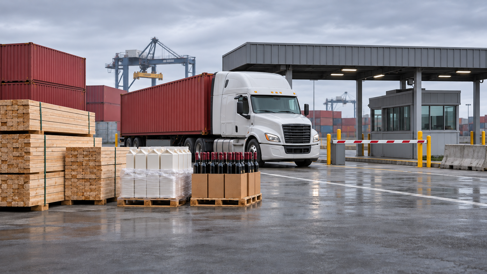

# 본문 이미지 스타일 지침

매 편 원고의 내용을 설명하면서 채널 전체의 이미지가 같은 그림처럼 보이지 않게 만든다. 기존의 종이 질감 시사 삽화와 청록·남색·크림색 팔레트는 선택지 중 하나다. 월호 표지, 썸네일의 제목 위계, 본문 제목·자막 배치와 불투명도는 [공통 지침](../영상_제작_지침.md)을 따른다.

## 화풍 선택

| 스타일 | 어울리는 소재 | 화면 설계 예 |
| --- | --- | --- |
| 사진풍 | 자연·환경·교통·산업 현장 | 자연광, 실제 비율과 재질, 풍경 전경과 사물 클로즈업 |
| 플랫 벡터 | 경제·무역·기술·사회 제도 | 기하학적 형태, 선명한 제한 색상, 비대칭 구성 |
| 아이소메트릭 3D | 물류·에너지·도시·제품 | 위에서 비스듬히 본 공간, 입체 사물과 부드러운 그림자 |
| 종이 콜라주 | 국제 관계·문화·소비 변화 | 오려낸 형태와 층, 대비되는 색면, 사물 중심의 비유 |
| 수채화·구아슈 | 생활·문화·여가·생태 | 부드러운 붓질, 주제에 맞는 새 팔레트, 여백 있는 풍경 |
| 펜화·디지털 페인팅 | 역사·산업·기술·사회 이슈 | 선과 명암 또는 붓질을 살린 장면, 장면 크기와 시점 변화 |

주제와 스타일을 일대일로 고정하지 않는다. 경제 원고도 사진풍이나 콜라주로 표현할 수 있다. 특정 스타일을 사용자가 지정한 경우 그 요청을 우선한다.

## 제작 순서

1. 최근 3편의 실제 이미지와 `image-prompts.json`, 제작 기록을 확인한다. 다운로드용 샘플이 교체되어도 남아 있는 로컬 제작자료나 Git의 해당 제작 커밋을 참고할 수 있다.
2. 이번 원고의 핵심 사물·환경·행동을 먼저 정한다. 모든 문장을 회의실 인물이나 태블릿을 보는 사람으로 바꾸지 않는다.
3. 직전 편과 다른 주 화풍을 기본으로 선택하고, 화풍·주조색·구도 중 최소 2가지를 바꾼다. 같은 주 화풍을 유지해야 할 명확한 내용상 이유가 있으면 그 이유를 기록하고 색감과 구도는 바꾼다. 이를 위해 사용자 확인을 매번 요청하지 않는다.
4. 장면표에 각 이미지의 화풍, 팔레트, 피사체, 시점·장면 크기를 적는다. 5장이라면 최소 3가지 구도를 사용하고 인물 없는 사물·풍경 장면도 포함한다.
5. 이번 편의 첫 장면을 새 스타일로 만든 후 필요한 장면의 참조로 사용한다. 한 편의 조명·재질은 연결하고, 인물이 실제로 이어지는 장면에만 같은 인물을 쓴다. 설명에 도움이 되면 사진풍 현장과 3D 개념 장면처럼 주·보조 화풍을 함께 설계할 수 있다.
6. 최근 영상의 대표 이미지와 이번 장면들을 나란히 확인한다. 배경과 인물만 바뀌고 색감·질감·구도가 같으면 프롬프트를 고쳐 다시 생성한다.
7. 최종 이미지 세트와 교체 시점은 영어 자막·한글 해석·제목만 표시하는 세 회차에 그대로 재사용한다.

프롬프트의 매체·질감·빛·팔레트·시점은 이번 선택에 맞게 새로 쓴다. `refined illustrated realism`, `subtle paper texture`, `warm cream, muted teal, navy, peach` 같은 이전 문구 묶음을 모든 원고에 자동으로 붙이지 않는다. 상단 약 10퍼센트와 하단 약 25퍼센트는 자막을 올릴 수 있게 단순하게 구성하되 매번 같은 크림색 빈 띠를 생성하지 않는다.

이미지에 제목·자막·임의 숫자·그래프·로고·재생 버튼 같은 불필요한 기호를 생성하지 않는다. 사진풍도 창작 개념 이미지이며 실제 사건의 현장 사진으로 설명하지 않는다. 원고의 가능성·전망을 이미 발생한 재난·폐업·합의 장면으로 단정하지 않는다.

## 같은 소재의 세 가지 비교 시안

11월 11일 관세 원고의 화물차·컨테이너·유제품·와인·목재를 공통 소재로 생성했다. 스타일 차이를 비교하기 위한 시안이며 실제 사건의 기록 사진이 아니다. 아래 시안은 기존 완성 영상과 구분해 보관한다.

| 시안 | 선택한 차이 |
| --- | --- |
| [플랫 벡터](assets/image-styles/flat-vector.png) | 파랑·흰색·코럴, 평면 도형, 비대칭 전경 |
| [아이소메트릭 3D](assets/image-styles/isometric-3d.png) | 라일락·민트, 입체 미니어처, 내려다보는 시점 |
| [사진풍](assets/image-styles/photographic.png) | 회색·붉은색, 흐린 자연광, 재질을 살린 현장 전경 |

### 플랫 벡터

### 아이소메트릭 3D

### 사진풍

생성 프롬프트와 수정 내용은 [시안 생성 기록](assets/image-styles/prompts.json)에 보관한다. 이 세 가지 외의 스타일도 원고에 맞게 사용할 수 있다.

## 제작 기록에 남길 내용

`image-prompts.json`과 제작 기록에 주 화풍, 보조 화풍이 있다면 그 용도, 주요 색상, 장면별 구도, 비교한 최근 영상, 선정 이유를 남긴다. 예: “최근 시사 삽화와 구분하기 위해 아이소메트릭 3D와 라일락·민트를 선택. 물류 전경·제품 클로즈업·시설 탑뷰를 배치.” 스타일 비교 시안은 제작 완료 에피소드 이력에 포함하지 않는다.
