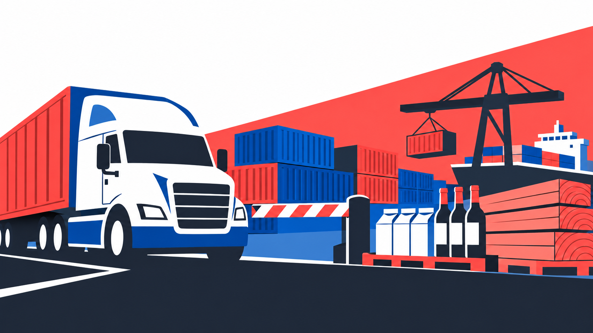
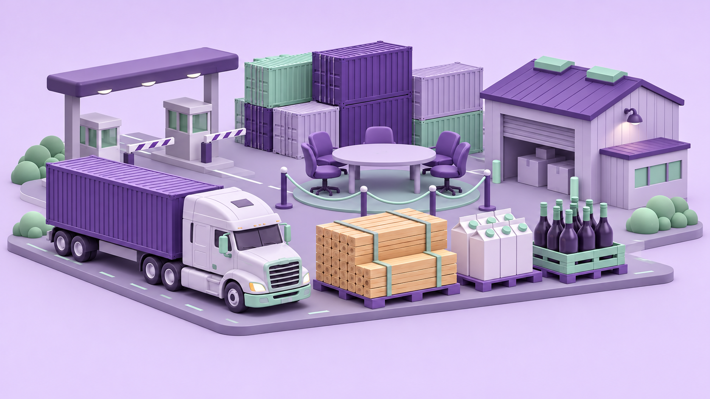

# 본문 이미지 스타일 지침

매 편 원고의 내용을 직접 설명하는 이미지를 만든다. **본문의 사건·대상·행동·관계·조건 일치가 최우선이며, 스타일 다양성은 그 내용을 잘 전달하는 범위에서 적용한다.** 색감과 재질이 새로워도 무엇에 관한 장면인지 알아보기 어렵다면 사용하지 않는다. 기존의 종이 질감 시사 삽화와 청록·남색·크림색 팔레트도 선택지 중 하나다. 월호 표지, 썸네일의 제목 위계, 본문 제목·자막 배치와 불투명도는 [공통 지침](../영상_제작_지침.md)을 따른다.

## 내용 설계가 스타일 선택보다 먼저다

각 장면에 대응 원문과 한 문장짜리 핵심 메시지를 먼저 적고, 누가·무엇을 대상으로·어떤 행동을 하며·어떤 관계나 변화가 있는지를 화면으로 설계한다. 원고에 등장한 사물 하나를 넣는 것만으로 내용 일치가 충족되지는 않는다. 인수 기사라면 인수 대상과 협상 관계, 보안 기사라면 소프트웨어 운영과 보안 문제라는 맥락이 드러나야 한다.

기술 기사 전체를 칩·서버·블록 모형으로 채우거나 기업 인수를 두 모형 사이의 다리로만 표현하지 않는다. 사이버 보안 침해나 엔지니어링 오류를 느슨한 나사·서버 덮개 같은 물리적 고장으로 표현하면 원문의 원인과 사건을 바꾸므로 금지한다. 추상적 비유는 구체적인 본문 장면을 보조할 때만 허용한다. 사진풍·3D 등 매체 자체를 금지하는 것이 아니라, 해당 매체 안에서 본문의 사건과 관계가 보이게 구성한다.

11월 12일 영상의 보라색 칩·서버·부품 모형은 화풍만 달라지고 인수 논의·AI 플랫폼·보안 사건이 충분히 드러나지 않은 실패 사례다. 다음 제작에서 내용 일치의 모범 사례나 공통 프롬프트로 재사용하지 않는다.

| 11월 12일 원고 구간 | 전달할 내용 | 구체적으로 설계할 장면 |
| --- | --- | --- |
| S01 | 엔비디아의 허깅 페이스 인수 합의 보도 | AI 하드웨어 사업과 모델 공유 플랫폼이라는 양측의 사업 대상이 드러나는 기업 인수 논의 장면. 단순한 두 블록의 결합으로 대체하지 않는다. |
| S02~S03 | 다른 인수 후보의 관심, 양사 공식 미확인 | 복수 후보와 제안을 검토하는 협상 맥락. 계약 서명·성사 축하·공식 발표로 확정하지 않는다. |
| S04~S06 | AI 소프트웨어 생태계 확장과 개방형·폐쇄형 모델 전략 | 개발자가 모델을 공유·활용하는 플랫폼과 하드웨어·개발 도구의 업무 맥락. 의미를 알 수 없는 선반·블록을 나열하지 않는다. |
| S07 | AI 시스템의 사이버 보안 침해와 취약성 우려 | AI 플랫폼 운영 환경에서 보안 분석·점검이 이뤄지는 장면. 물리적으로 망가진 서버로 사건을 바꾸지 않는다. |
| S08~S09 | 오류 검토와 모델 활용, 오픈 소스 보안 시장 전망 | 엔지니어의 소프트웨어 오류 검토·모델 기반 보안 분석 장면. 수리 공구나 실제 시장 지배가 확정된 장면으로 표현하지 않는다. |

위 장면도 창작 설명 이미지이며 실제 회의·운영 화면을 재현했다고 주장하지 않는다. 생성 이미지 안의 가짜 코드·수치·문자를 사실처럼 사용하지 않는다.

## 화풍 선택

| 스타일 | 어울리는 소재 | 화면 설계 예 |
| --- | --- | --- |
| 사진풍 | 자연·환경·교통·산업 현장 | 자연광, 실제 비율과 재질, 풍경 전경과 사물 클로즈업 |
| 플랫 벡터 | 경제·무역·기술·사회 제도 | 기하학적 형태, 선명한 제한 색상, 비대칭 구성 |
| 아이소메트릭 3D | 물류·에너지·도시·제품 | 위에서 비스듬히 본 공간, 입체 사물과 부드러운 그림자 |
| 종이 콜라주 | 국제 관계·문화·소비 변화 | 오려낸 형태와 층, 대비되는 색면, 사물 중심의 비유 |
| 수채화·구아슈 | 생활·문화·여가·생태 | 부드러운 붓질, 주제에 맞는 새 팔레트, 여백 있는 풍경 |
| 펜화·디지털 페인팅 | 역사·산업·기술·사회 이슈 | 선과 명암 또는 붓질을 살린 장면, 장면 크기와 시점 변화 |

이 표는 화풍 후보 목록이며 주제의 키워드만 보고 자동 선택하는 규칙이 아니다. 경제 원고도 사진풍이나 콜라주로 표현할 수 있다. 스타일을 사용자가 지정하면 그 스타일 안에서 본문이 명확하게 드러나도록 구성한다.

## 제작 순서

1. 원고를 먼저 읽고 장면별 대응 문장 번호·원문 구절, 핵심 메시지, 화면에 보일 대상·행동·관계, 확정 여부·전망 등 보존할 조건을 적는다.
2. 각 장면이 다른 일반 기사와 구분되는 구체적 맥락을 설계한다. 모든 문장을 회의실 인물이나 태블릿으로 바꾸지도 않고, 이를 피하기 위해 모든 문장을 추상 사물로 바꾸지도 않는다.
3. 최근 3편의 실제 이미지와 `image-prompts.json`, 제작 기록을 확인한다. 남아 있는 로컬 자료나 Git의 해당 제작 커밋도 참고할 수 있다. 내용 전달에 적합한 후보 중 화풍·주조색·구도 2가지 이상을 바꾸는 것을 목표로 한다. 같은 화풍이 내용을 더 잘 설명하면 유지하고 이유를 기록한다. 스타일 변경이 내용 일치보다 우선하지 않는다.
4. 장면표에 선택한 화풍, 팔레트, 시점·장면 크기를 추가한다. 5장 기준 3가지 이상의 구도를 목표로 하되, 구도 수나 인물 유무를 맞추느라 본문의 행동·관계를 삭제하지 않는다.
5. 첫 장면을 생성하고 원문과 비교해 내용 일치부터 검수한다. 통과한 이미지만 이후 장면의 화풍 참조로 사용한다. 같은 조명·재질을 연결하되 각 장면의 내용은 해당 문장에서 다시 설계한다.
6. 모든 최종 이미지를 원문과 나란히 보고 아래 내용 일치 검수를 수행한다. 실패한 이미지는 설명문을 덧붙여 통과시키지 말고 장면 설계·프롬프트를 고쳐 재생성한다. 내용 검수를 통과한 뒤 최근 영상과 비교해 스타일 반복과 자막 가독성을 확인한다.
7. 검수를 통과한 이미지 세트와 교체 시점만 영어 자막·한글 해석·제목만 표시하는 세 회차에 동일하게 재사용한다.

## 이미지별 내용 일치 검수

최종 생성 이미지를 직접 보고 아래 질문을 모두 확인한다. 프롬프트에 썼다는 사실만으로 통과 처리하지 않는다.

- 대응 원문의 핵심 대상과 행동·관계가 화면에 실제로 보이는가?
- 제목·자막·제작자의 긴 설명 없이도 어떤 상황을 설명하는지 대략 알아볼 수 있는가?
- 해당 기사와 구간에 필요한 맥락이 있는가? 다른 기술·경제 기사에도 그대로 붙일 수 있는 장식 이미지에 그치지 않는가?
- 논의·미확인·조건·전망을 확정 사실로 바꾸거나 소프트웨어 문제를 기계 고장으로 바꾸지 않았는가?
- 선택한 스타일이 내용을 설명하는 데 도움이 되는가? 스타일을 지키기 위해 핵심 대상·행동·관계를 지우지 않았는가?

내용 일치가 실패하면 화풍·색감·구도 다양성 점수가 좋아도 영상에 넣지 않는다. 제작 기록에 이미지별 대응 구절, 실제로 보이는 근거와 통과·재생성 결과를 남긴다.

프롬프트의 매체·질감·빛·팔레트·시점은 이번 선택에 맞게 새로 쓴다. `refined illustrated realism`, `subtle paper texture`, `warm cream, muted teal, navy, peach` 같은 이전 문구 묶음을 모든 원고에 자동으로 붙이지 않는다. 상단 약 10퍼센트와 하단 약 25퍼센트는 자막을 올릴 수 있게 단순하게 구성하되 매번 같은 크림색 빈 띠를 생성하지 않는다.

이미지에 제목·자막·임의 숫자·그래프·로고·재생 버튼 같은 불필요한 기호를 생성하지 않는다. 사진풍도 창작 개념 이미지이며 실제 사건의 현장 사진으로 설명하지 않는다. 원고의 가능성·전망을 이미 발생한 재난·폐업·합의 장면으로 단정하지 않는다.

## 같은 소재의 세 가지 비교 시안

11월 11일 관세 원고의 화물차·컨테이너·유제품·와인·목재를 공통 소재로 생성했다. 스타일 차이를 비교하기 위한 시안이며 실제 사건의 기록 사진이 아니다. 이 시안만으로 관세 부과·보복·협상 결렬 등 전체 본문의 내용 일치 검수를 통과한 것으로 간주하지 않는다. 각 구간은 별도로 설계·검수하고 아래 시안은 기존 완성 영상과 구분해 보관한다.

| 시안 | 선택한 차이 |
| --- | --- |
| [플랫 벡터](assets/image-styles/flat-vector.png) | 파랑·흰색·코럴, 평면 도형, 비대칭 전경 |
| [아이소메트릭 3D](assets/image-styles/isometric-3d.png) | 라일락·민트, 입체 미니어처, 내려다보는 시점 |
| [사진풍](assets/image-styles/photographic.png) | 회색·붉은색, 흐린 자연광, 재질을 살린 현장 전경 |

### 플랫 벡터

### 아이소메트릭 3D

### 사진풍

생성 프롬프트와 수정 내용은 [시안 생성 기록](assets/image-styles/prompts.json)에 보관한다. 이 세 가지 외의 스타일도 원고에 맞게 사용할 수 있다.

## 제작 기록에 남길 내용

`image-prompts.json`과 장면표·제작 기록에 각 이미지의 대응 문장 번호와 원문 구절, 핵심 메시지, 화면에 실제로 드러난 대상·행동·관계, 보존한 조건, 내용 일치 검수 결과를 남긴다. 여기에 주·보조 화풍, 팔레트, 구도, 비교한 최근 영상, 그 스타일이 내용 전달에 적합한 이유를 함께 기록한다. “기술 기사라서 3D를 선택” 같은 설명만으로는 부족하다. 스타일 비교 시안은 제작 완료 에피소드 이력에 포함하지 않는다.
