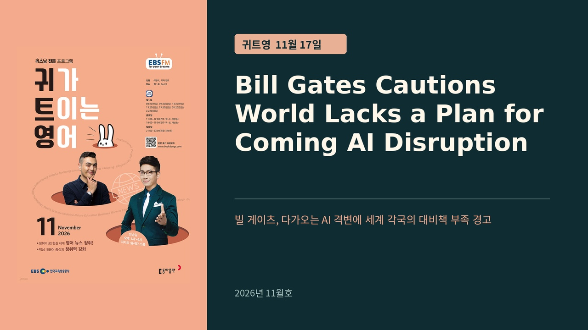

# 2026년 11월 17일 귀트영 영상 다운로드

영어 제목은 **Bill Gates Cautions World Lacks a Plan for Coming AI Disruption**, 한글 제목은 **빌 게이츠, 다가오는 AI 격변에 세계 각국의 대비책 부족 경고**이다. 제공한 11월 17일 원고와 기존 2026년 11월호 원본 표지로 제작했다.

- [영상 다운로드](2026-11-17-bill-gates-ai-disruption-us-female.mp4)
- [썸네일 다운로드](thumbnail.jpg)
- [전체 제작자료 ZIP 다운로드](https://github.com/jrkim3888/english_ebs_video/blob/work/examples/2026-11-17/2026-11-17-production.zip)

영상과 ZIP은 Git LFS 파일이다. 링크를 열고 **Download raw file**을 누르면 실제 파일을 내려받을 수 있다. Git으로 받았다면 Git LFS를 설치하고 `git lfs pull`을 실행한다.

요청한 **미국 여자** 음성에 **1배속**을 적용했다. 영상은 약 **3분 38초**, **1920×1080**, 30fps다. 제목을 한 번 낭독하고 본문 전체를 영어 자막, 한국어 해석, 제목만 표시하는 순서로 세 번 반복한다.

빌 게이츠의 경고·업무 자동화·노동자 재교육·국내외 조정 제안·청정에너지와 질병 연구의 가능성을 구체적인 잉크·구아슈 편집 삽화 5장으로 설명한다. 이미지와 교체 시점은 세 회차에 동일하게 재사용한다. 대체 위험·정책 제안·기술의 잠재적 기여를 확정 결과와 구분했다. 창작 설명 이미지이며 특정 실제 발언 행사나 정책 시행 현장의 기록 사진이 아니다.

상단 제목은 작은 한 줄, 제목 배경 불투명도는 65퍼센트, 자막 배경은 약 55퍼센트다. 원문 9문장·174단어와 자막 20개 구간의 일치, 실제 TTS 시점, 본문 PCM 반복, 전체 디코딩과 각 회차 대표 화면을 확인했다. 이미지별 원문 대응과 내용 일치 검수 근거는 제작자료에 보관했다. 전체 음성 수동 청취 검수는 하지 않았다.

전체 제작자료에는 최종 영상과 썸네일, 원본 표지와 이미지, 원고와 해석, 음성과 자막 시점, 장면표와 내용 검수 기록, 생성 프롬프트, 제작 코드와 최신 지침을 포함한다. 사용자 요청에 따라 이전 11월 16일 샘플 영상과 해당 제작자료 ZIP은 현재 브랜치에서 제거했다.

